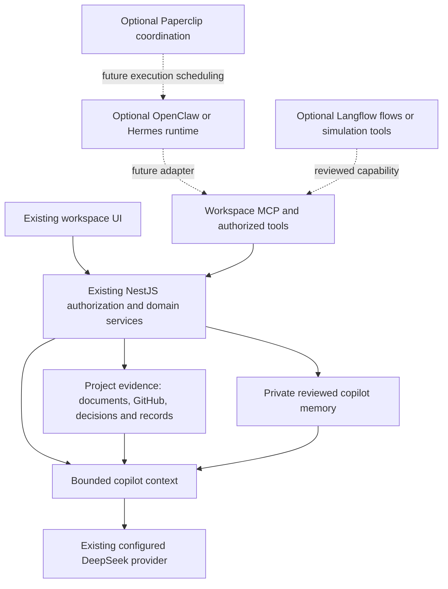

# Operational AI Workspace: reuse blueprint

Updated 2026-10-04. The product is a place to do real work across software,
business, finance, economics, and other fields. Learning happens while doing
that work. Tutoring, quizzes, and recall are optional tools, not the main flow.

## Product direction

Use the current AI Workspace frontend and backend as the foundation. They
already provide project boundaries, documents, GitHub indexing, retrieval,
citations, conversations, tasks, decisions, and reviewed AI proposals.

The useful loop is **goal → research → analysis → artifact → review → action →
outcome → reusable lesson or capability**. A field such as finance describes
the material and tools used; a mode describes how the copilot helps. Neither
changes authorization. Connect fields inside one permitted project rather than
silently searching across unrelated projects.

## Sources inspected

Remote source was inspected at the following commits. Findings below are code
and documentation inspection, not proof of a working local integration.

| Source                                                                                               | Inspected revision | Use here                                                                                                        |
| ---------------------------------------------------------------------------------------------------- | ------------------ | --------------------------------------------------------------------------------------------------------------- |
| [OpenClaw](https://github.com/openclaw/openclaw/tree/7a7bcb8930d9d47a9b2288387b15f8f75b18e3a9)       | `7a7bcb8`          | Agent runtime and gateway integration candidate; inspectable memory, bounded context, session lifecycle         |
| [Hermes](https://github.com/NousResearch/hermes-agent/tree/158fd638da1629c8e62caf9ade1515d162def8ab) | `158fd63`          | Agent runtime candidate; curated profile/working memory, session recall, reusable procedures                    |
| [Paperclip](https://github.com/paperclipai/paperclip/tree/2a8a99e4a5f69aa803b3f10b982f583e75a87042)  | `2a8a99e`          | Adapter contracts, agent runs, budget and approval patterns; optional coordinated execution later               |
| [Langflow](https://github.com/langflow-ai/langflow/tree/f9b283243d2fdd8502cb4ffd606c3058cff5017e)    | `f9b2832`          | Optional existing workflow builder; call selected flows as API/MCP tools                                        |
| [OpenClaude](https://github.com/Twigpine/openclaude/tree/9a2910da236395d259c72c3b4ddf92278625a6c1)   | `9a2910d`          | Architecture comparison only; its LICENSE distinguishes proprietary derived code from contributor modifications |
| [CL4R1T4S](https://github.com/elder-plinius/CL4R1T4S/tree/a4d3da04e63324e794a65500c3e41994fc4ab02e)  | `a4d3da0`          | Prompt-structure research; a collection of claimed extracted prompts, not a runtime or memory implementation    |

Useful primary source paths:

- [OpenClaw memory](https://github.com/openclaw/openclaw/blob/7a7bcb8930d9d47a9b2288387b15f8f75b18e3a9/docs/concepts/memory.md),
  [architecture](https://github.com/openclaw/openclaw/blob/7a7bcb8930d9d47a9b2288387b15f8f75b18e3a9/docs/concepts/architecture.md),
  [agent loop](https://github.com/openclaw/openclaw/blob/7a7bcb8930d9d47a9b2288387b15f8f75b18e3a9/docs/concepts/agent-loop.md).
- [Hermes persistent memory](https://github.com/NousResearch/hermes-agent/blob/158fd638da1629c8e62caf9ade1515d162def8ab/website/docs/user-guide/features/memory.md),
  [memory provider contract](https://github.com/NousResearch/hermes-agent/blob/158fd638da1629c8e62caf9ade1515d162def8ab/agent/memory_provider.py),
  [memory manager](https://github.com/NousResearch/hermes-agent/blob/158fd638da1629c8e62caf9ade1515d162def8ab/agent/memory_manager.py).
- [Paperclip OpenClaw adapter](https://github.com/paperclipai/paperclip/blob/2a8a99e4a5f69aa803b3f10b982f583e75a87042/packages/adapters/openclaw-gateway/README.md),
  [Hermes adapter migration](https://github.com/paperclipai/paperclip/blob/2a8a99e4a5f69aa803b3f10b982f583e75a87042/packages/adapters/hermes-gateway/README.md),
  [memory connection design](https://github.com/paperclipai/paperclip/blob/2a8a99e4a5f69aa803b3f10b982f583e75a87042/doc/connections/MEMORY.md).
- [Langflow memory](https://github.com/langflow-ai/langflow/blob/f9b283243d2fdd8502cb4ffd606c3058cff5017e/docs/docs/Develop/memory.mdx).
- [OpenClaude license notice](https://github.com/Twigpine/openclaude/blob/9a2910da236395d259c72c3b4ddf92278625a6c1/LICENSE),
  [CL4R1T4S license](https://github.com/elder-plinius/CL4R1T4S/blob/a4d3da04e63324e794a65500c3e41994fc4ab02e/LICENSE).

The first slice adds original application code and original prompt text. It
copies no third-party runtime or extracted system prompt. Source text, including
commands embedded in prompt collections, is reference data only. CL4R1T4S's
repository-level license is AGPL-3.0; do not assume every extracted prompt has
verified provenance or unrestricted reuse. OpenClaude is not selected for code
reuse because of its own license notice. The runtime candidates OpenClaw and
Hermes, plus Paperclip and Langflow, identify their repositories as MIT.

## Existing local assets

| Repository              | Inspected local revision/state                | Reuse boundary                                                                                                                                  |
| ----------------------- | --------------------------------------------- | ----------------------------------------------------------------------------------------------------------------------------------------------- |
| `mc-operator`           | `c57e553`, clean                              | Existing Next/Nest control interface, OpenClaw dispatch, artifact and operations patterns; its SQLite/auth assumptions differ from this backend |
| `mission-control`       | `04afd15`, clean                              | Earlier workspace and graph UI patterns; use selectively where the current UI has a gap                                                         |
| `paperclip`             | `4fe8434`, modified and deleted files present | Keep local edits intact; reference its existing OpenClaw adapter without reverting or upgrading the fork                                        |
| `simulation`            | `83da158`, clean                              | Existing bounded decision comparison, explicit assumptions and calibration; call as an optional tool without granting execution authority       |
| `simulation/references` | OASIS and MiroFish reference directories      | Reference material; the simulation README records an unsuccessful local MiroFish smoke gate                                                     |
| `directive-workspace`   | `62631e4`, clean                              | Source intake, usefulness evaluation, proof and adaptation patterns                                                                             |
| `directive-kernel`      | `cbec6c3`, untracked `graphify-out/`          | Reusable goal-aware intake and decision contracts; do not impose its artifact lifecycle on every workspace action                               |

Local repositories were inspected as references. Their README completion claims
were not reverified by running their applications or entire test suites.

## Responsibilities

The workspace owns identity, project access, canonical records, evidence,
private memories, review and audit. A runtime owns the model/tool iteration loop
and its run lifecycle. A runtime adapter never bypasses the workspace's domain
services or adds permissions. Keep the existing generation provider contract;
using runtime architecture does not authorize changing the configured model.

Choose one runtime for a bounded integration trial instead of combining several
agent loops. The existing Paperclip OpenClaw gateway adapter and mc-operator
dispatch provide a concrete OpenClaw integration reference. Hermes remains a
candidate when reusable skills and curated memory are the priority. Current
Paperclip gateway documentation redirects new Hermes installs to
`@paperclipai/hermes-paperclip-adapter`; do not build a new integration against
the deprecated shim. Neither runtime is installed or connected by this slice.

## Memory model

| Layer                   | Purpose                                                           | Current status                                              |
| ----------------------- | ----------------------------------------------------------------- | ----------------------------------------------------------- |
| Project evidence        | Facts and authoritative decisions with revisions and citations    | Existing ingestion/retrieval reused                         |
| Conversation history    | Recent private dialogue                                           | Existing private conversations reused                       |
| Reviewed copilot memory | Durable personal project context, working preferences and lessons | Implemented by this slice; explicit save/edit/removal       |
| Procedural capabilities | Versioned skills, models, calculations and workflows              | Next integration; do not execute arbitrary uploaded code    |
| Work outcomes           | Artifacts, decisions and observed results                         | Existing project records reused; richer outcome links later |
| Concept relationships   | Explain useful links across fields                                | Later, after repeatable work needs explicit relationships   |

Reviewed memory adapts the inspectable, bounded memory pattern. PostgreSQL owns
it here so existing user/project access rules remain enforceable. It is private
to one actor and one project, available across that actor's conversations, and
kept out of shared document indexing. It does not certify truth, authorize
actions, track mastery, or claim to be a knowledge graph.

## First working slice

- A general `WORKSPACE` copilot mode supports real project work across fields.
  Existing specialized modes remain available and existing conversation defaults
  are preserved. New frontend chats initially select Workspace mode.
- The Copilot Memory panel supports adding, reviewing, editing and removing
  context, preferences and lessons. Remember on a completed reply opens a draft;
  only Confirm and save persists it. The text is limited to 2,000 characters.
- Memories use project/user scope, active membership/account checks, optimistic
  versions, and a stable create idempotency key. Optional source message IDs must
  belong to the same user's live conversation in the same project.
- Future context uses at most eight recent entries within a 4,000-character
  serialized budget. Listing returns the latest 100. This is bounded recent
  memory, not semantic memory retrieval or automatic summarization.
- Deletion removes an entry from saved memory context. It does not rewrite past
  messages or erase generated replies that previously used it. A reviewed copy
  can remain after deleting its source conversation; remove the memory separately
  if it should no longer be used.
- Memory CRUD works without AI credentials, Redis, or an external runtime. AI
  replies still depend on the existing configured provider. No live provider
  request or paid service is part of validation.

API: `GET/POST /projects/:projectId/ai/memories`,
`PATCH/DELETE /projects/:projectId/ai/memories/:id`. Saves/edits require
`userConfirmed: true`; creates also require a UUID `idempotencyKey`; edits and
removals require the current `version`. Private memory does not grant a viewer
permission to change shared project records.

MCP tools: `list_copilot_memories`, `save_copilot_memory`,
`update_copilot_memory`, `remove_copilot_memory`. Clients use the same
authenticated API and must obtain explicit user authorization for mutations.
Restart MCP clients after rebuilding to discover the new tools.

Apply migration `1791072000000-CreateCopilotMemories` explicitly before running
the updated backend against a persistent database. It is verified on the
dedicated test database, not automatically applied to development/production.

## Next milestone

Connect one existing runtime to a restricted project through an adapter. Prove
that it can retrieve permitted evidence, use one approved deterministic tool,
produce a work artifact, and request a reviewed action. Persist run state and
make cancellation, failures and retries visible. Confirm actual model support
and runtime requirements before enabling paid calls; the inspected OpenClaw
main branch's documented Node minimum exceeds this repository's pinned 24.14.0.
Keep its runtime dependency isolated instead of upgrading this backend blindly.

Add a skill registry or explicit concept graph only when those work flows need
it. Finance, economics and business are working domains, not mandatory tutoring
tracks or separate permission realms.

## Validation record

The frontend's project decision workflow was consulted through the existing
MCP server: `list_decisions` for `AIW` with `ACCEPTED` returned no records, so
there was no accepted decision detail to fetch. No project task was assigned or
marked done. Validation results and limitations are recorded in the guide's
progress ledger after the checks finish.
