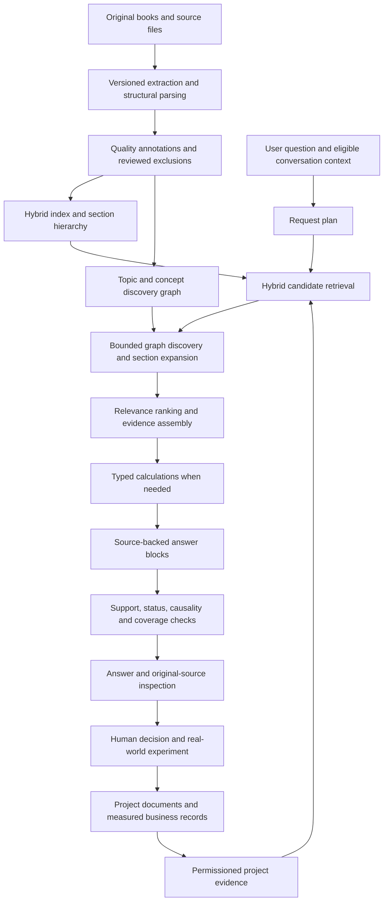

# OSCAR knowledge intelligence: architecture and delivery plan

Date: 2026-10-30. Status: **proposed implementation plan**. No feature in this document becomes implemented, measured, or authorized for external execution by being described here.

## 1. Objective and definition of success

Make OSCAR useful for real decisions: understand the question, find substantive evidence, explain a defensible interpretation, distinguish project observations from assumptions, and produce an actionable answer with inspectable sources.

A useful business answer should let its reader determine:

1. What decision or question is being answered?
2. Which source passages and actual project observations support it?
3. Which parts are attributed principles, user inputs, calculations, hypotheses or recommendations?
4. What alternatives and missing evidence could change the conclusion?
5. When action is requested, what is a feasible next step and how will its result be interpreted?

Definitions, short pitches and book-only questions should retain their requested form. They do not require a full business experiment. Source grounding is a provenance requirement, not a guarantee that a recommendation is correct. The system must not imply it has read every book for each answer or found every possible relevant reference.

The supplied NotebookLM diagram is a useful conceptual workflow, not a verified specification of Google's internal implementation. Its 30/70 human/AI split is not a planning metric. This roadmap is an OSCAR design proposal, not a claim that we can reproduce an undocumented product architecture.

## 2. Starting point and evidence

Current reference baseline: backend `d1b02f1`, building on the retrieval changes in `30390f3` and the sibling Knowledge service. Recheck current Git state before implementation; these are baseline references, not instructions to reset a checkout.

Existing capabilities to retain:

- NestJS backend, independent Python Knowledge service, PostgreSQL/pgvector, existing frontend and MCP tools.
- Keyword/semantic retrieval, bounded query expansion, named-source handling, graph discovery hints and source diversity.
- Physical-page citation provenance, full indexed-passage inspection, immutable answer evidence captures and source-review v9.
- Project documents, private conversations, source access controls, reviewed memory and versioned proposal confirmation.
- A real MCP evaluation runner, source-preservation checks and private business-question diagnostics.

Observed failures that determine priority:

- Financial prose multiplied minutes by an hourly labor cost without conversion, despite citations and review.
- Advice inferred a single cause from low visits, non-payment or non-adoption without ruling out alternatives.
- Filtering removed a direct answer or requested artifact; the interview-question case needed special handling.
- Intermittent review failures withheld otherwise generated answers.
- Some retrieved material is outline/navigation content or lacks surrounding explanation.
- A topic connection can find another passage without establishing that the passage supports the question.

The prior run had 47 real generation attempts and 99 re-read library passages. Software checks passed, but some semantic failures remained. Its previously reserved questions were used for fixes and cannot serve as a clean final holdout. Use that suite for regression and create new reserved questions.

The configured OSCAR MCP decision lookup failed during this planning pass. Do not infer that no decisions exist. Retry before implementation and reconcile any accepted decisions with the current repository rules. The checked-in guide and current code were inspected for this plan.

The repository's model instructions and documented runtime default have diverged. Phase 0 must reconcile that documentation/configuration discrepancy explicitly. This plan does not switch the existing generation model, embedding provider, revision, dimensions or credentials.

## 3. Target architecture

Permission checks, deadlines, versioning and telemetry apply throughout the flow. Graph traversal and section expansion never widen access. Generated answers, summaries and graph descriptions never automatically become observed project facts.

### Responsibility boundaries

| Component                                  | Responsibility                                                                                                                | Must not assume                                                             |
| ------------------------------------------ | ----------------------------------------------------------------------------------------------------------------------------- | --------------------------------------------------------------------------- |
| Knowledge service                          | Original-source extraction, quality metadata, hierarchy, retrieval, reference graph and original passage windows              | Project facts, user business intent, answer generation or permission to act |
| Main backend                               | Request intent, project evidence, permissioned source orchestration, calculations, answer validation and persisted provenance | That a reference principle proves a project's outcomes                      |
| Frontend                                   | Source inspection, meaningful progress, correction/review and decision/experiment workflows                                   | That a citation or graph edge means verified correctness                    |
| Existing document/memory/proposal services | Reviewed persistence, provenance, scope, versions and idempotency                                                             | Automatic promotion of model suggestions into facts or executed actions     |
| Evaluation tooling                         | Frozen cases, evidence labels, failure traces and explicit reviewer identity                                                  | That a model's self-review is independent human validation                  |

Keep the unified library experience. Subject, document type and quality are useful facets, not separate knowledge silos. Retain the standalone graph page, connected to citations and chat.

## 4. Source and evidence design

### 4.1 Preserve original material and lineage

Keep original PDFs/files unchanged. Store extraction outputs, quality assessments, annotations, indexes and generated summaries as distinct versioned derivatives. Every answerable unit needs source/document ID, revision, active generation, source locator, extraction method, text hash, owner/access scope and original-page mapping.

Represent document structure explicitly where available:

`document → chapter → section → paragraph/table/formula → searchable chunk`.

Do not invent headings, merge different editions silently, or assume PDF page numbers equal printed page numbers. Preserve both when known. Quality corrections create a new derivative/index generation with comparison and rollback; they do not overwrite the original or silently change past answer snapshots.

### 4.2 Assess four independent dimensions

| Dimension      | Assessment                                                                                            | Use in the system                                                                                     |
| -------------- | ----------------------------------------------------------------------------------------------------- | ----------------------------------------------------------------------------------------------------- |
| Faithfulness   | Reading order, text accuracy, table cells, formulas, units and OCR artifacts against original pages   | Flag unreliable extraction; route critical mathematics/tables for original-page review                |
| Completeness   | Original content versus extracted content versus search snippet versus assembled model context        | Identify whether a gap is extraction loss, truncation, retrieval failure or genuinely absent evidence |
| Depth          | Explanation, worked example, outline, definition, index, references, promotion or visual-only content | Prefer substantive explanations; keep indexes as discovery pointers                                   |
| Answer support | Whether a particular passage supports the particular claim and its qualifiers                         | Validate per answer; a generally good book is not automatically relevant support                      |

Quality labels must identify their method and reviewer. Automated heuristics produce signals, not certified grades. Unknown quality stays unknown. Preserve existing exclusions and quarantines; graph linkage or re-indexing cannot reactivate excluded content.

### 4.3 Start with a bounded quality pilot

Choose approximately 20 high-value sources from actual question needs and different formats. Audit up to 120 selected pages, covering explanatory prose, tables, formulas, scans, complex layouts and random pages where those types exist. Record the sampling method and substitutions; a selected sample does not certify the whole library.

Deliver a source registry showing original availability, extraction generation, coverage limitations, content depth, review status and repair priority. Prioritize a damaged page that blocks a real answer over cosmetic cleaning of irrelevant material.

### 4.4 Keep reference knowledge and project evidence distinct

Reference books supply attributed principles. Project records supply observations or reported accounts about a business. Conversation history supplies eligible conversational context. These remain distinguishable even when searched together.

For project evidence, use independent fields rather than one misleading “verified” boolean:

- `evidenceStatus`: observed, user-reported, planned, hypothesis or derived.
- `reviewStatus`: proposed, reviewed, rejected or superseded.
- Provenance: original document/revision/span or actual record and its author.
- Dates: record date, observation period and review date, kept separate.
- Measurement: metric definition, value, unit, denominator, sample, currency/period where applicable.
- Scope: project, owner, privacy and access rules.

An owner-approved forecast is still a forecast. A recalled interview account is still self-report unless actually observed. Missing measurement is not a zero result. New owner intent may supersede older intent; it cannot rewrite historical measured outcomes.

## 5. Retrieval and orchestration

### 5.1 Build a bounded request plan

Introduce a validated internal `RequestPlan` describing intent, requested outputs, selected/named sources, project-application permission, needed concepts, calculation requirements, freshness needs, evidence gaps and execution budget.

Initially use deterministic request parsing with small typed extraction only where necessary. Do not add an unconditional model planning call to every request. The current user's request controls scope; instructions embedded in source files cannot modify the plan or authorize actions.

Support definitions, comparisons, synthesis, business advice, calculations and artifact drafting. Mixed questions must retain each requested part. “Explain the books without project application” must remain reference-only. “Give five questions” requires five supported questions or an explicit explanation of the shortfall.

### 5.2 Retrieve for relevance and coverage

Start with the existing hybrid implementation, not a new database stack:

1. Keep the original question as an anchor.
2. Use up to four bounded searches for distinct requested concepts or named sources.
3. Merge and deduplicate candidates across editions, overlapping chunks and repeated imports.
4. Rerank for relevance, explanatory depth, necessary qualifiers and coverage of requested concepts.
5. Expand selected hits to surrounding sections where context is insufficient.
6. Add bounded graph candidates only where they fill a relevant gap.
7. Assemble a budgeted evidence pack with stable provenance and explicit missing-source notices.

Initial tuning experiments can compare pools of 20 and 40 candidates, retaining approximately 8–12 passages under the existing context ceiling. These are hypotheses to benchmark, not guaranteed optimal defaults. Source diversity is a soft constraint: do not discard the best explanation just to increase the number of books.

### 5.3 Retrieve the surrounding explanation

The current full-passage endpoint returns the full indexed chunk, which is not necessarily its parent section or neighboring pages. Add a bounded, permissioned passage-window/section operation rather than treating a larger preview as completed hierarchical retrieval.

The operation should:

- Require an authorized anchor document, revision and chunk/section identifier.
- Resolve neighbors server-side within the same permitted source and active generation.
- Return original spans and individual locators/hashes, not a synthetic merged quotation.
- Preserve qualifications, examples and relevant table/formula context where available.
- Apply explicit character, byte, chunk-count and time limits, including Unicode tests.
- Reject stale revisions and unavailable/excluded spans; never infer access from an anchor alone.

Start with at most two selected section expansions per answer and benchmark their marginal benefit. Avoid loading complete books into every request.

### 5.4 Pilot contextual indexing and reranking

Test short source/section context annotations and reranking on the selected subset. Annotations assist search but remain separate from original text; citations must resolve to the original passage. Generated descriptions cannot supply missing empirical facts.

Anthropic describes contextual augmentation and reranking as retrieval techniques, but its benchmark gains are not OSCAR results. Measure our own retrieval and downstream answers before any broader re-embedding. [Contextual Retrieval](https://www.anthropic.com/research/contextual-retrieval)

Avoid changing existing vector identities in place. A pilot uses a separate generation/namespace and explicit activation. Only consider an additional reranker model after measuring the existing ranking; assess local latency, memory, licensing and operational cost before adoption.

## 6. Deterministic numerical reasoning

This is the first implementation priority because the current failure is concrete and independently testable.

### 6.1 Typed calculation requests

Add a backend calculation module with a finite set of validated operations, initially:

- Contribution per unit and contribution ratio.
- Zero-profit break-even and target-profit units.
- Labor-time and rate conversions.
- Funnel conversion, percentage change and basic cohort rates.
- Simple scenario totals and explicitly defined cash movements.

Each input has a value, unit, period/currency where applicable, evidence span or explicit user-input provenance, and actual/hypothetical status. Preserve a supplied total variable cost; when using components, identify missing components rather than treating them as zero. Reject incompatible periods, mixed currencies without an explicit rate, ambiguous denominators, unsupported cost classification and division by zero.

The model may propose an operation and map inputs. Runtime validation and deterministic code perform the calculation. Do not execute arbitrary model-generated expressions, code, SQL or network requests. Use exact decimal/rational representations or a deliberately evaluated pinned decimal dependency; avoid unqualified floating-point currency arithmetic.

### 6.2 Publish a calculation receipt

Persist operation/version, inputs and provenance, conversion steps, result, rounding, assumptions and validation status. The answer cites the source principle separately from explicitly attributed user inputs and calculated results. A mathematically valid receipt does not certify that an input is a real business observation.

### 6.3 Acceptance examples

- Monthly price 20, total variable cost 5, fixed costs 600: contribution 15; zero-profit units 40; units for target profit 300 equal 60.
- Support 45 minutes at 12 per hour plus other variable cost 3: labor 9, total variable cost 12; at price 20/fixed cost 600, break-even 75.
- Price below variable cost with positive fixed costs: no nonnegative finite break-even volume under constant inputs.
- Zero contribution and positive fixed costs: no finite break-even result; no division-by-zero output.
- Orders 20 to 30: 50% count increase; no inferred conversion increase or causal effect without additional evidence.
- Fractional required units round upward; negative counts, unknown cost components, zero denominators and mixed periods are handled explicitly.

The first calculator is bounded. Forecasting, accounting compliance, causal estimation and financial planning beyond the supported operations remain separate capabilities.

## 7. Synthesis, evidence status and causal discipline

Represent an answer's public reasoning as concise, inspectable premises and conclusions, not a claim to expose a model's hidden reasoning.

For material conclusions, retain a `ClaimSupport` record linking the claim to source spans and identifying whether it is an attributed source claim, project observation, user assumption, calculation, hypothesis or recommendation.

For a synthesis, require:

1. Relevant premise A and premise B, with original evidence.
2. An explicit relationship: complement, qualification, disagreement, application or analogy.
3. A conditional implication and its limit.
4. When action is requested, the observation or experiment that would discriminate between options.

Do not manufacture agreement between authors or require several sources for a claim that one good passage establishes. Separate shared vocabulary from an actual conceptual relationship.

For causal or motivational conclusions, check temporal order, denominator changes, confounders and alternative explanations. No clicks, no payment or no link sharing alone identifies a unique cause. An observational pilot can suggest a hypothesis; a comparison needs its assumptions stated. Do not prescribe an A/B test when traffic or practical constraints make it uninformative—offer an appropriate smaller investigation instead.

The current source reviewer remains one signal. Model-only grading cannot be represented as independent verification, and a score is not a calibrated probability. Disagreements, unsupported premises and missing evidence should be visible rather than silently resolved into confident prose.

## 8. Complete answers and reliable review

### 8.1 Replace fragile text-only assembly incrementally

Introduce validated internal `AnswerBlock` records for direct answers, explanations, calculations, recommendations, questions, tables, limitations and source gaps. Each block carries claim references and required-output tags. Render Markdown after validation.

Preserve structural units: an interview question plus its rationale, a complete table row/group, a formula plus assumptions, and a recommendation plus its decision rule. Do not retain a conclusion after removing its necessary qualification or antecedent.

Retain the existing renderer/reviewer behind a rollout flag while adding the typed path. Ordinary prose can continue to use sentence checks inside a structurally complete block. Do not bypass support validation to meet a requested word count or item count.

### 8.2 Check coverage after support review

Compare the surviving blocks with the request plan: direct answer present, requested parts covered, specified sources addressed or their gaps disclosed, requested artifact/count intact, calculation units/assumptions present, and explicit no-application constraints preserved.

Allow at most one bounded redraft using only the already authorized evidence and calculation receipts. Review new material again. If completeness cannot be restored within the budget, show a useful partial answer and a scoped missing part. Do not fabricate five questions when only three can be supported.

### 8.3 Diagnose review failures

Use the new safe schema/coverage/unavailable codes to distinguish provider failure, invalid JSON/schema, missing IDs and oversized review requests. Add bounded schema recovery only for an identified recoverable format error. Never retry solely because the answer received an unfavorable verdict. Retain failed attempts and original request identity.

## 9. Evidence-linked graph enrichment

Keep PostgreSQL and the current graph; a new graph database is not required for the initial pilot.

Add versioned concept/section relationships on a selected subset:

- Nodes: source edition, chapter/section, concept and approved project evidence where appropriate.
- Candidate edge types: mentions, explains, exemplifies, qualifies, contradicts, prerequisite-for and applies-to.
- Provenance: supporting original spans, extraction method, revision/generation and review status.

Start with explicit mentions and checked examples. Richer semantic edges are proposals until inspected. Similarity, same-topic membership or co-occurrence cannot establish agreement, causality or contradiction.

At query time, begin with relevant direct hits; permit one graph hop and a small candidate cap, initially eight. Rerank neighbors against the actual question and verify their original passages. Keep valid direct hits so graph expansion cannot displace the anchor evidence merely because it is highly connected.

Permission-filter nodes, edges, summaries and aggregate counts before traversal and return. A shared concept must not expose the title, existence, counts or description of a private book. Revocations and source updates invalidate derived graph access and cached results.

Microsoft GraphRAG's local-search design combines graph information with original document text; it does not make graph relationships a substitute for text evidence. Its project also recommends starting small because indexing can be expensive. Treat it as a design reference, not a drop-in requirement. [Local search](https://microsoft.github.io/graphrag/query/local_search/), [GraphRAG project](https://github.com/microsoft/graphrag)

## 10. Business learning loop and product interaction

Use existing projects, documents, goals, memories and reviewed proposals before creating overlapping persistence models. Extend existing entities only where their semantics and access controls fit; inspect the exact schema in implementation.

A decision record should connect:

`business question → observations → source principles → recommendation → proposed experiment → actual result → revised decision`.

The record includes owner, date, constraint, alternatives, hypothesis, action, cost/time budget, baseline/comparison, metric/denominator, period, proposed decision rule, outcome provenance, confounders and follow-up.

Support a realistic workflow:

1. User asks about an actual business decision.
2. OSCAR presents evidence and a proposed next test.
3. User reviews any proposed records through the existing confirmation flow.
4. Real observations are entered/uploaded with dates and provenance.
5. OSCAR compares the outcome with the predeclared rule, preserves limitations and proposes a revised decision.

Do not automatically contact merchants, run ads, change prices, create tasks, approve canonical memories or mark an experiment successful. Those remain ordinary user-authorized domain actions. Suggestions alone never create measured outcomes.

Frontend additions should be small and functional:

- Expand a citation to its original passage and surrounding authorized section.
- Distinguish source principle, reported project fact, assumption and calculation without overloading every sentence with badges.
- Show exact coverage gaps and useful next inputs.
- Link graph exploration back to source paragraphs and optionally to the current question.
- Provide “wrong source,” “missing part,” “wrong calculation,” “outdated fact” and “useful next step” feedback with consented retention.
- Use actual processing stages for progress; do not present an unreviewed streamed draft as a verified final answer.

## 11. Evaluation and proposed release gates

### 11.1 Datasets and reviewer discipline

Keep the old twenty cases as regression cases. Prepare a new approximately 60-case suite: 40 development and 20 genuinely reserved cases, stratified by business task, source availability, artifact type, source-only scope and difficult numerical/causal cases. Freeze criteria before generation. Add human-labelled relevant passages for a smaller retrieval subset; record alternative valid passages rather than assuming a single correct source.

Use synthetic data for unit/integration tests and private actual questions for live acceptance. Keep benchmark answers, labels and reviewer comments outside the reference/project index to prevent feedback contamination. Record who reviewed each case, including whether the reviewer was an agent or a human. Obtain owner review of a manageable set of actual decisions rather than demanding a full-book audit before any use.

Microsoft's evaluation guidance separates document retrieval, groundedness, relevance and completeness. This roadmap adopts that distinction without requiring Azure or treating an evaluator score as truth. [RAG evaluation guidance](https://learn.microsoft.com/en-us/azure/foundry/concepts/evaluation-evaluators/rag-evaluators)

### 11.2 Targets to validate, not achieved claims

| Area                            | Proposed initial gate                                                                                                         | Scope/limitation                                                                 |
| ------------------------------- | ----------------------------------------------------------------------------------------------------------------------------- | -------------------------------------------------------------------------------- |
| Access and provenance           | No known cross-user/project leak; every published citation resolves to its authorized captured source version                 | Includes graph counts, neighbors, caches, revocation and stale-source tests      |
| Supported calculator operations | All curated deterministic arithmetic/unit tests pass; source/user input mapping explicitly checked                            | Not a guarantee for arbitrary financial questions                                |
| Critical business errors        | Zero observed critical invented facts, unit errors or unjustified causal diagnoses in the release sample                      | Zero observed failures in a small sample does not establish zero population risk |
| Retrieval                       | Target at least 90% known relevant-premise coverage within the top 20 on the labelled subset                                  | Human-labelled incomplete ground truth; report by query class                    |
| Answer coverage                 | At least 90% of answerable cases retain the direct answer and required artifact/parts                                         | Correctly identified unanswerable parts scored separately                        |
| Practical usefulness            | At least 85% meet the task-specific usefulness rubric in reviewer inspection, with no critical failures hidden by averages    | A proposed pilot threshold, not current measured accuracy                        |
| Scope and status                | All controlled no-application and planned-versus-observed regressions pass                                                    | Expand cases as new failures occur                                               |
| Reliability                     | At least 95% of live pilot requests finish without provider/review transport failure; all failures are visible and retry-safe | Report counts and denominators; no silent rerolling                              |
| Performance                     | Aim for p95 under 45 seconds for ordinary supported questions, under 75 seconds for explicit deeper synthesis                 | Measure on the actual machine; revise before shipping if unattainable            |

Report semantic failure examples, unsupported recommendations, inappropriate refusals, incomplete answers and slow tails alongside averages. A retry must not erase a first failure. Holdout cases used to tune a fix become regression cases, and new reserved cases are needed for the next independent check.

### 11.3 Real-world usefulness

Track whether the user could choose a next action, how much editing was necessary, what evidence was missing, and whether subsequent results confirmed or changed the decision. Keep time saved and business outcomes separate from software completion. A well-grounded suggestion can still be commercially ineffective.

## 12. Performance, cost, security and operations

- Use shared request deadlines and cancellation across embedding, searches, graph traversal, section expansion, generation and review. Provisional ceilings: 60 seconds ordinary, 90 seconds explicitly deeper work; tune against measured p95 rather than hiding timeouts.
- Default to one generation and one review. A total model-call cap, provisionally six, includes any typed input extraction, optional planning/checking, one redraft and its review. It is a ceiling, not a target. Skip optional graph/extra searches or return a scoped partial answer when budget is exhausted.
- Record stage timings, safe identifiers, candidate/selection counts, source revisions, calculator operation IDs, review reasons and token counts. Raw private prompts and passages stay in consented private evaluation artifacts, not operational logs.
- Cache only with identity/access scope, selected source set, revisions/generations, query-plan version and relevant project-evidence versions. Revalidate access at return time; invalidate on revocation, deletion, exclusion or source updates. Never share private answer context across projects/users through a cache.
- Additive migrations only; explicitly backed-up persistent stores and isolated test databases. No re-embedding in place or resetting the library to repair a test.
- Capture provider/embedding identities and index generations. No silent provider substitution, paid-service fallback or model-weight download.
- Budget indexing from a measured pilot: pages/chunks per hour, tokens per annotation, storage growth and failed-job rate. Set a capped batch and evaluate benefit before broadening it.
- Preserve source notices/licenses and the existing private/shared access model. A generated derivative does not expand permission to distribute its underlying material.

## 13. Delivery sequence and estimates

Estimates are focused engineering days for one implementation lane using the existing stack. They assume prepared local services and timely review. They exclude exhaustive PDF repair, whole-library semantic indexing and waiting for actual merchant outcomes.

| Phase | Deliverable                                                                                                                            | Dependency                            | Estimate                           |
| ----- | -------------------------------------------------------------------------------------------------------------------------------------- | ------------------------------------- | ---------------------------------- |
| 0     | Confirm baseline/configuration, preserve data, define fresh evaluation labels, measure stage latency and reconcile model documentation | None                                  | 0.5–1 day                          |
| 1     | Typed deterministic calculations, unit validation and calculation receipts                                                             | 0                                     | 1–2 days                           |
| 2     | Structured answer units, post-filter coverage, bounded repair and review-failure diagnosis                                             | 0; integrate 1                        | 1–2 days                           |
| 3     | Permissioned section windows, question-aware candidate ranking and complementary evidence packs                                        | 0; integrate 2                        | 2–3 days                           |
| 4     | Selected-source quality registry, page audit/repairs and contextual indexing/reranking pilot                                           | 0; benefit measured with 3            | 1–3 days plus source-review effort |
| 5     | Evidence-linked concept graph pilot and bounded query expansion                                                                        | 3–4                                   | 2–4 days                           |
| 6     | Decision/experiment evidence loop using existing records and reviewed actions                                                          | 1–3                                   | 1–2 days                           |
| 7     | Source-window/feedback UI, full pilot acceptance, rollback exercise and operating documentation                                        | 1–6; incremental UI can start earlier | 1–2 days                           |

Planning range: approximately 10–19 engineering days before contingency, or roughly **3–5 working weeks** with integration/review allowance. This is not a commitment. A first useful checkpoint—calculations and preservation of complete answers—should be targeted in **3–5 focused days**, before the broader graph work.

Do not postpone useful corrections until every book is mapped. Conversely, do not label the entire architecture complete at the first checkpoint. Actual business validation requires the observation period chosen for each real experiment.

### Phase-specific exit checks

- **0:** reproducible baseline, source/model fingerprints, protected private outputs, explicit new reserved set, and no assumed accepted ADRs.
- **1:** arithmetic and unit examples above pass; ambiguous inputs stay explicit; replay returns the saved calculation/answer without duplicated writes.
- **2:** direct-answer, five-question, complete-table, source-gap and no-application cases survive appropriate checks; unsupported text is not restored merely for completeness.
- **3:** same-source permitted context expansion recovers needed assumptions/examples, while stale or unauthorized neighbors fail; matched-question evaluation improves relevant-premise coverage without unacceptable latency.
- **4:** pilot pages have auditable findings, not blanket clean labels; new index generation can be activated/reverted; measured answer benefit justifies any added indexing.
- **5:** inspectable original support for retained edges, no private aggregate leaks, and ablation shows whether graph expansion helps beyond hybrid retrieval plus section windows.
- **6:** a proposed experiment and a later entered result remain distinct, versioned and permissioned; no implied external execution or measured success.
- **7:** fresh reserved results reviewed, known failures documented, source inspection works in the main app, performance/cost measured and rollback demonstrated.

## 14. Implementation locations and proposed contracts

These names are design proposals; choose exact file/schema names after reviewing current modules.

| Area                         | Likely location                                                      | Proposed change                                                     |
| ---------------------------- | -------------------------------------------------------------------- | ------------------------------------------------------------------- |
| Request planning             | Backend `assistant/context` and `knowledge-client`                   | `RequestPlan`, output requirements, scoped budgets                  |
| Numerical reasoning          | New backend calculation module integrated through assistant services | Validated `CalculationRequest` and immutable `CalculationReceipt`   |
| Answer assembly/review       | Backend `assistant/context`, evidence snapshots                      | `AnswerBlock`, `ClaimSupport`, `CoverageResult`, safe failure codes |
| Source windows               | Knowledge API/retrieval, backend Knowledge client                    | Bounded window/section request and original-span response           |
| Source quality and structure | Knowledge ingestion/indexing/schema                                  | Versioned hierarchy and `SourceQualityAssessment`                   |
| Reference graph              | Existing Knowledge graph code and graph page                         | Evidence-linked, permissioned concept relationships                 |
| Project learning             | Existing documents/goals/proposals/memory modules                    | Dated evidence and decision/experiment links, reviewed promotion    |
| Evaluation                   | Existing live runner and private datasets                            | Retrieval labels, semantic/task coverage and stage metrics          |

Candidate additive endpoint: a source-window operation anchored by document/chunk/revision, with server-resolved same-source neighbors and strict byte/character limits. Do not expose a raw client-supplied adjacency query. Backend validation must check returned identity, revision and scope before assembling context.

Keep existing clients compatible where possible. Additive response audit fields must not turn historical snapshots into current evidence. Version changed contracts, generate OpenAPI and test the exact old/new behavior. Extend existing domain persistence rather than duplicating decision or experiment concepts under unrelated services.

## 15. Rollout and rollback

1. Land small verified commits on `main` under the existing workflow; do not introduce a `develop` branch or push without user direction.
2. Use independent feature controls for typed calculations, block coverage/repair, section expansion, ranking experiments and semantic graph expansion.
3. Evaluate candidate retrieval in shadow mode first, retaining existing user-visible behavior until evidence warrants activation. Do not publish an experimental answer simply because it has more citations.
4. Activate a small source/project pilot, inspect failures and compare against the same baseline questions.
5. Expand only after the relevant gates pass and costs/latency are acceptable. Mark reviewed versus experimental capabilities visibly where useful.
6. Roll back feature behavior and active index generation without dropping originals, grants, past evidence captures, reviewed project records or existing embeddings.

Disabling a calculator must not cause unchecked model arithmetic to be presented as validated output. If a required validation path is unavailable, provide the supported explanation and explicit missing verification. Preserve retry identity and avoid duplicated domain writes during rollback/replay.

## 16. Deferred work and completion boundaries

Not part of the first usable checkpoint:

- Exhaustively auditing every PDF page or certifying all extraction as complete.
- Building semantic relations for every passage or importing a new graph database.
- Changing/fine-tuning generation models or implementing a mixture-of-experts model.
- Making every answer cite many books, or promising all relevant references are retrieved.
- Audio/video overviews and other output formats before the evidence/answer path is reliable.
- Automatically executing business advice or turning generated summaries into measured facts.

Mixture-of-experts routing inside an LLM and routing questions across a knowledge library are different mechanisms. This plan improves the latter and the verification surrounding generation. It does not require training or modifying an LLM's internal architecture.

Completion is declared per phase with evidence. The first checkpoint is complete when typed numerical operations and required answer components work under their tests. The controlled pilot is complete when the applicable access, provenance, usefulness, coverage, reliability and performance gates are met on its documented sample. The full corpus remains a separate measured maintenance program.

## 17. Immediate execution order

1. Recheck repository state and accepted decisions, reconcile model documentation, preserve baseline fingerprints and establish fresh reserved cases.
2. Implement calculation receipts and dimensional checks using the observed labor-cost and break-even failures.
3. Replace the next text-filtering special case with structured answer/coverage handling; diagnose review failures from actual safe error codes.
4. Add bounded section context to recover explanation, assumptions and examples.
5. Measure the first release against baseline before expanding quality indexing, graph semantics or UI scope.

This sequence favors observable business-answer improvements over a large architectural rewrite or a larger-looking graph.
