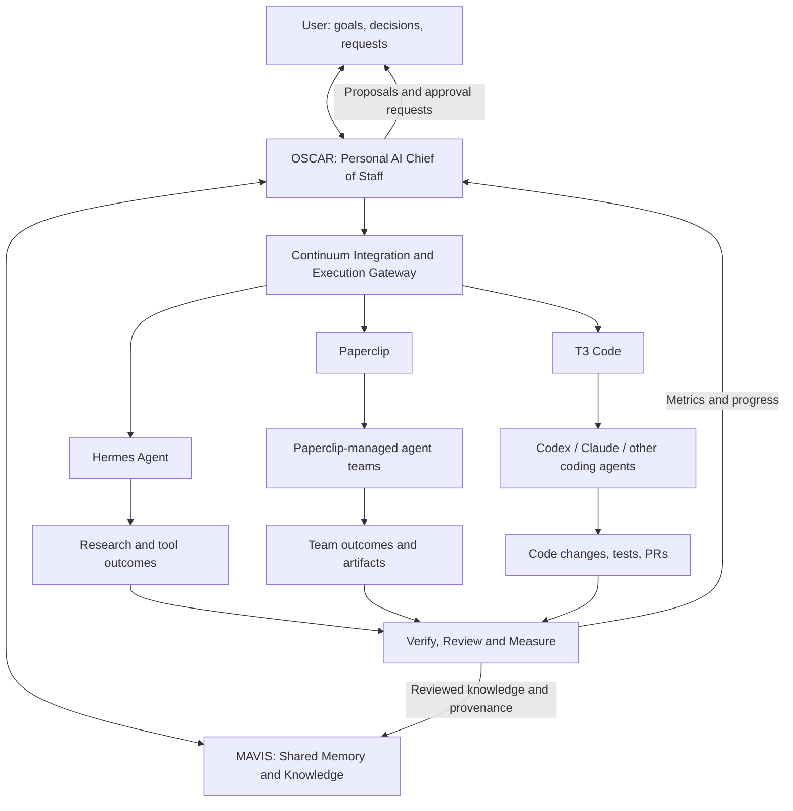

# OSCAR & MAVIS
## A Personal AI Chief of Staff, Powered by a Shared Intelligence and Memory System

**Product vision and architecture blueprint**  
**Version:** 1.0 — proposed direction  
**Date:** 18 October 2026  
**Origin:** The existing *Continuum* frontend and backend  
**Status:** Vision and implementation plan. Features described as *planned* are not claims of current functionality.

---

## 1. Executive vision

### The idea in one sentence

**Build a personal AI Chief of Staff that understands my long-term ambitions, helps me think and operate like a business builder, coordinates specialized AI systems, remembers what matters across all of them, and continuously connects work to measurable goals.**

The user-facing assistant is **OSCAR**. The shared memory and continuity system beneath it is **MAVIS**. The existing **Continuum** codebase is the starting foundation, not an architecture that must be discarded or rewritten.

This is not meant to be another chat application, a generic project-management tool, or a new coding-agent framework. It is a personal intelligence and execution platform: a durable relationship between **my intentions**, **what I know**, **the AI systems available to me**, and **what actually gets accomplished**.

### The fundamental product promise

> **One personal assistant. Many capable AI systems. Shared knowledge. Goal-directed action. Continuity over time.**

The system should be able to answer four questions reliably:

1. **Where am I trying to go?** — My goals, motivations, priorities, constraints, and definitions of success.
2. **What do we know?** — Relevant, attributable, up-to-date memory, evidence, and lessons from prior work.
3. **What should we do next?** — Strategic options, trade-offs, priorities, decisions, and an actionable plan.
4. **What actually happened?** — Agent activity, artifacts, validated outcomes, metrics, and learnings that influence the next decision.

### Primary focus

**Personal assistance, with an emphasis on goals, business, strategy, and execution.**

OSCAR should help with business development, finance and economic reasoning, research, strategic planning, software products, operating decisions, and coordination of specialized agents. Everyday personal assistance remains useful, but is a supporting capability rather than an excuse to build a sprawling general consumer app.

**Initial audience:** Me. Build an excellent personal system first. Potential wider distribution is a later business decision, not a design assumption that should dominate the first implementation.

---

## 2. Names, identities, and responsibilities

### 2.1 OSCAR — the executive-facing intelligence

**O.S.C.A.R. = Objective-driven Strategic Coordinator for Action & Results**

**Role:** Personal AI Chief of Staff, business strategist, executive assistant, and goal-oriented coordinator.

OSCAR is **who I interact with**. Its job is not simply to answer a prompt, but to understand the larger objective behind it. OSCAR should:

- Maintain awareness of active goals, projects, priorities, deadlines, and resources.
- Think in terms of objectives, strategy, opportunity cost, risks, and measurable results.
- Advise on business models, market opportunities, product decisions, budgets, and execution plans.
- Identify contradictions between current activity and stated priorities.
- Choose or recommend the right specialized AI system for a task.
- Coordinate approved work without silently exceeding the authority I granted.
- Review outputs, surface uncertainty, and return important findings to shared memory.
- Remain coherent across sessions, models, computers, and agent-provider changes.

**OSCAR's guiding question:** *“Given the goals and evidence, what is the most valuable next action?”*

OSCAR is an assistant, **not** an autonomous legal executive or the final decision-maker. I remain accountable for business, financial, privacy, and operational decisions.

### 2.2 MAVIS — the shared memory and continuity intelligence

**M.A.V.I.S. = Memory-Augmented Virtual Intelligence System**

**Role:** Persistent, permission-aware memory, knowledge retrieval, history, provenance, and context continuity.

MAVIS is **what makes the wider ecosystem remember**. It should preserve meaningful knowledge across OSCAR, Hermes, Paperclip, T3 Code, and future AI systems.

MAVIS should:

- Store personal preferences and approved personal context.
- Preserve goals, project history, source documents, strategic decisions, and their revisions.
- Index outcomes and lessons from work executed by external agents.
- Retrieve relevant information without flooding agents with entire transcripts.
- Distinguish confirmed facts from hypotheses, suggestions, estimates, and unverified agent output.
- Respect user/project access boundaries, retention preferences, exclusions, and deletion semantics.
- Provide versioned, cited context that another runtime can use even if the original model is gone.
- Support correction, supersession, source links, and export so the system is not locked to one AI provider.

**MAVIS's guiding question:** *“What relevant, reliable context can we recover, and where did it come from?”*

MAVIS is **not** automatically another chatbot, autonomous executive, or an unquestionable source of truth. Its core is a memory and knowledge service with intelligent selection and consolidation.

### 2.3 Continuum — the existing foundation

Continuum is the current name of the software foundation from which OSCAR and MAVIS will evolve:

- [continuum-frontend](https://github.com/mengchheanglong/continuum-frontend)
- [continuum-backend](https://github.com/mengchheanglong/continuum-backend)

**Working branding proposal:**

- **OSCAR:** Main assistant and possibly the eventual public-facing product name.
- **MAVIS:** Independent shared-memory and continuity subsystem.
- **Continuum:** Existing repositories/internal platform codename until a deliberate branding and migration decision is made.

A future product could be presented as **“OSCAR — powered by MAVIS.”** That is a branding direction, not a requirement to rename packages, migrations, local databases, or deployed systems immediately.

### 2.4 Why separate OSCAR from MAVIS?

If OSCAR's model changes, MAVIS remains. If Hermes is replaced, MAVIS remains. If T3 Code or Paperclip is upgraded or removed, MAVIS remains. Additional assistants can later share approved portions of the same memory without becoming copies of OSCAR.

**OSCAR owns the assistant experience and goal interpretation. MAVIS owns shared continuity. Each external engine retains ownership of its own live execution.**

---

## 3. The problem this solves

### Today's fragmentation

Modern AI work spreads across conversations, IDE agents, agent orchestration tools, documents, repositories, dashboards, and local files. Each application often has a partial, separate understanding of the user or the project.

Consequences include:

- Re-explaining the same product vision and decisions to different models.
- Losing important reasoning when a chat ends or a provider changes.
- Agents repeating research that another agent already completed.
- Task completion being mistaken for meaningful strategic progress.
- Several systems independently managing work without a shared objective.
- Valuable lessons disappearing into logs and conversational noise.
- Becoming dependent on an AI vendor for access to accumulated personal context.

### The deeper problem

The issue is not merely that AI tools fail to share chat history. They fail to share **intent, authoritative decisions, evidence, outcomes, and an evolving understanding of what matters**.

A unified chat interface alone cannot solve that. OSCAR needs goal awareness; MAVIS needs durable, trustworthy knowledge; the integration layer needs real permissions and execution state; and the overall system needs a feedback loop grounded in outcomes rather than activity.

---

## 4. Product philosophy and guiding principles

1. **Goals before activity.** Every significant project or agent task should have a reason to exist, even when that reason is exploration or learning.
2. **Personal-first.** Optimize for actual daily use, not a feature checklist for an imaginary enterprise customer.
3. **Human authority.** OSCAR can recommend, plan, and supervise; important external actions, money movement, irreversible changes, and strategic commitments require appropriate user authorization.
4. **Own the knowledge, not necessarily the execution engine.** Reuse mature agent systems through adapters instead of cloning them.
5. **One source of authority for each kind of state.** Continuum/MAVIS owns canonical personal and workspace knowledge; native engines own their live sessions and execution details.
6. **Memory must have provenance.** Store where a claim came from, its scope and date, whether it was reviewed, and whether it has since been corrected.
7. **Evidence is not a command.** Retrieved files, web pages, code, and agent logs are untrusted inputs, not authority to override permissions or instructions.
8. **Results over reports.** A completed agent run is not the same as a successful business outcome.
9. **Modular and replaceable.** Models, orchestration engines, embeddings, and execution platforms are replaceable behind stable contracts.
10. **Progressive autonomy.** Begin read-only and supervised; expand autonomy only after measurable reliability and safeguards.
11. **Privacy by design.** Never assume private user memory should be shared with every agent or every project.
12. **Do not build infrastructure just because it is interesting.** Each addition should prove a real improvement in a user workflow.

---

## 5. The end-to-end operating loop

The core loop is:

**Goal → Understand → Research → Strategize → Decide → Delegate → Execute → Verify → Measure → Remember → Adapt**

| Stage | What happens | Responsible system |
|---|---|---|
| Goal | Establish what success means and why it matters | User + OSCAR |
| Understand | Retrieve current state, constraints, history, and facts | OSCAR + MAVIS |
| Research | Investigate unknowns and produce cited findings | Hermes or approved specialist |
| Strategize | Compare opportunities, trade-offs, and plans | OSCAR, assisted by relevant agents |
| Decide | Approve goals, spending, commitments, and major choices | User |
| Delegate | Route work to the right execution environment | OSCAR integration gateway |
| Execute | Perform approved research, coding, or multi-agent work | Hermes, T3 Code, Paperclip |
| Verify | Inspect sources, tests, deliverables, and policy compliance | Native engine + OSCAR + user as needed |
| Measure | Compare real outcomes against success metrics | OSCAR / goal layer |
| Remember | Persist useful, appropriately reviewed findings | MAVIS |
| Adapt | Reprioritize, revise strategy, or stop low-value work | OSCAR proposes; user decides |

This loop applies to building a software company, validating an idea, improving revenue, developing a product, or exploring an ambitious long-term project.

---

## 6. Goal-centered product model

Continuum's earlier organizing concept was **Workspace → Project → Task**.

The new conceptual hierarchy should be:

**Person → Vision → Goal → Strategy → Initiative → Project → Task → Agent Run → Deliverable → Outcome → Lesson**

Not every everyday request needs to instantiate every layer. This is a conceptual model and a set of optional links, not a requirement to turn simple conversations into bureaucratic records.

### 6.1 Vision and goals

A **vision** describes a desired future. A **goal** describes a measurable objective or meaningful milestone toward it.

Example:

- **Vision:** Establish a sustainable technology company.
- **Goal:** Validate a product with paying customers by a chosen date.
- **Success metrics:** Number of paying customers, retained revenue, gross margin, churn, cost to deliver.
- **Constraints:** Available time, funding, academic commitments, skills, legal requirements.
- **Strategy:** Narrow the market, solve a costly problem, test willingness to pay, then scale based on evidence.

A goal record should support: title, motivation, description, owner, status, timeframe, metrics, baseline, target, confidence/uncertainty, dependencies, risks, review cadence, and connected initiatives.

### 6.2 Strategies and decisions

A strategy is a chosen approach, **not** merely a list of tasks. OSCAR should record the alternatives considered, assumptions made, evidence used, reasons for choosing, triggers for reevaluation, and decision owner.

Decisions should support outcomes such as **proposed, approved, rejected, superseded**, with links to their sources and affected work.

### 6.3 Projects and tasks

Existing Continuum projects, documents, decisions, and Kanban tasks become *execution structures* connected to goals. A task can carry `goalId`/`initiativeId` relationships where useful. A project can serve several goals, but OSCAR should avoid claiming a connection without a clear rationale.

### 6.4 Outcomes and reviews

Each completed unit of work should record more than “done” when applicable:

- Expected result vs. observed result.
- Measured evidence and data quality.
- Artifacts, code changes, decisions, customers, revenue, or other real-world consequences.
- Time, resource, and provider cost where available.
- Next action, blockers, and a reusable lesson.

**Critical distinction:** A PR merged or an agent report generated is an *output*. A reduced error rate, paying customer, or improved business metric is an *outcome*.

---

## 7. What OSCAR should do

### 7.1 Personal Chief of Staff

OSCAR should be able to:

- Tell me what my active goals are and which are advancing or slipping.
- Suggest daily and weekly priorities based on deadlines, actual progress, and available capacity.
- Surface unresolved decisions or stalled projects before they are forgotten.
- Recognize when I am overcommitted or chasing new ideas at the expense of current objectives.
- Prepare concise summaries before important planning or business discussions.
- Explain recommendations using stored context and evidence, not vague motivational language.

An eventual daily brief could answer: **“What matters today, what changed, and what needs my decision?”**

A weekly strategic review could answer: **“What made progress, what produced measurable results, what failed, and what should change?”**

These are **planned capabilities**. They should not be advertised as currently running scheduled automations.

### 7.2 Business and strategic intelligence

The assistant should support:

- **Opportunity evaluation:** customer problem, market evidence, differentiation, competition, distribution, and timing.
- **Business model analysis:** pricing, value proposition, unit economics, operating costs, cash requirements, and sensitivity analysis.
- **Financial reasoning:** scenario planning, forecasts, budget comparisons, and explicitly labeled assumptions.
- **Product strategy:** priorities, user feedback, MVP scope, validation experiments, and launch decisions.
- **Operations:** delegation, status monitoring, bottlenecks, and dependencies.
- **Competitive and economic research:** sourced findings with timestamps and uncertainty.
- **Decision review:** alternative paths, downside scenarios, expected value, and conditions that invalidate the original plan.

OSCAR should distinguish source-backed findings, estimates, and recommendations. It should not invent current market numbers, guarantee investment returns, or treat a projection as actual financial performance.

### 7.3 General personal assistance

Normal chat and research remain first-class. Over time, optional integrations could support notes, reminders, schedules, documents, communications, and personal workflows. Personal information should be purpose-limited and shared with specialized agents only when needed and authorized.

### 7.4 A consistent assistant identity

OSCAR should feel like one persistent assistant even when execution is handed off to other systems. The agent that performed a task can be surfaced transparently, but the user should not need to relearn three unrelated products for common workflows.

Consistency comes from OSCAR's interaction rules and MAVIS's trusted context, **not** from assuming every runtime has the same internal identity, memory, tool permissions, or model state.

---

## 8. Ecosystem: use each engine for what it does well

### 8.1 Hermes Agent — general-purpose agent runtime

**Primary role:** Research, analysis, tool-based problem solving, and selected personal assistance workflows.

**Existing integration:** Continuum has a bounded Hermes subprocess bridge. The current implementation uses a pinned Hermes revision, a fresh temporary profile, and an explicit seven-tool allowlist. Native personal Hermes memory, plugin discovery, MCP, shell, and browser tooling are intentionally disabled in that bridge. The current run lifecycle has bounded iterations, tool calls, and a three-minute subprocess deadline.

**Implication:** A new connection to T3 or Paperclip is **not** automatically available to this restricted Hermes instance. New capabilities must be deliberately added through backend-controlled tools, or a separately designed and reviewed integration mode must be created.

**Desired future:** Hermes can act on OSCAR-approved tasks using narrowly scoped tools and relevant MAVIS context. It should not receive blanket access to private memory or local credentials.

### 8.2 Paperclip — autonomous agent organization and operations

**Primary role:** Coordinate teams of agents around goals and recurring business work.

Paperclip provides organization structures, agent roles, issues, goal alignment, approvals, budgets, heartbeats, work histories, and adapters for several agent runtimes, including Hermes and coding agents.

**Desired use inside OSCAR:**

- Organize recurring business/research/operations initiatives.
- Assign work to an agent team and track progress.
- Use Paperclip's existing governance, budget controls, and native task semantics.
- Return useful work products, execution state, and evidence to Continuum.

**Integration surfaces:** Paperclip's REST control-plane API and an experimental, opt-in OAuth-backed MCP connection for an external assistant. Exact available operations and access depend on the Paperclip version and instance configuration.

**Important:** Paperclip can already run Hermes, Codex, and Claude agents. OSCAR should not unnecessarily send the same assignment through both Paperclip and T3, or create a second incompatible team/approval system.

### 8.3 T3 Code — interactive coding agent control surface

**Primary role:** Work with coding agents such as Codex, Claude Code, and other supported providers; expose project, session, and thread operations.

**Desired use inside OSCAR:**

- Start or supervise a coding task on an explicitly selected repository.
- Follow a coding thread and inspect changes, tests, and results.
- Link the implementation back to original requirements and decisions.
- Persist significant outcomes into MAVIS with references to source commits, PRs, and tests.

T3 exposes an authenticated MCP interface in supported configurations. OSCAR should integrate against the **documented installed version**, preserve its native permission prompts, and avoid pretending that an MCP message equals a completed, reviewed code change.

### 8.4 Division of responsibilities

| Concern | Primary owner |
|---|---|
| Personal goals, priorities, and OSCAR conversation | Continuum / OSCAR |
| Canonical shared personal/workspace knowledge | Continuum / MAVIS |
| Shared memory permissions and provenance | Continuum / MAVIS |
| Interactive coding execution | T3 Code and its underlying coding agents |
| Autonomous agent-team execution, agent roles, native costs and budgets | Paperclip |
| General-purpose agent execution | Hermes or a supervised Paperclip-hosted Hermes worker |
| Native execution logs / live session state | The executing engine |
| Cross-platform external-run references and user-visible summaries | Continuum |
| Final approval for material decisions and high-impact actions | User, with native platform controls preserved |

The systems can communicate, but **there must be one clear execution owner per delegated unit of work**.

---

## 9. High-level architecture



### 9.1 Architectural layers

**A. Experience layer — OSCAR UI**  
Chat-first assistant, goal overview, business workbench, agent activity, projects, reviews, decisions, files, and memory controls.

**B. Goal and reasoning layer — OSCAR services**  
Goal context, planning, prioritization, capability selection, decision support, strategy tracking, and assistant behavior.

**C. Continuity layer — MAVIS services**  
Canonical sources, reviewed memories, temporal history, provenance, retrieval, correction/exclusion, and export.

**D. Integration layer — Continuum adapters**  
Authenticated connections to Hermes, Paperclip, T3, and future runtimes; capability discovery; scoped task dispatch; external ID mapping; status updates; artifact intake.

**E. Governance and lifecycle layer**  
Permissions, human approvals, idempotency, audit events, task ownership, durable runs, cancellation, retries, cost and usage reporting, and safe failure handling.

**F. Infrastructure layer**  
Existing NestJS API, Next.js frontend, PostgreSQL/pgvector, document storage, configured model providers, and locally or remotely hosted external agent systems.

### 9.2 The adapter approach

Use a stable *internal* interface rather than making every external product fit the exact same native API.

```ts
// Proposed interface — not an existing Continuum API.
interface AgentPlatformAdapter {
  platformId: string;

  capabilities(connectionId: string): Promise<Capability[]>;
  startWork(request: AuthorizedWorkRequest): Promise<ExternalRunReference>;
  getRun(ref: ExternalRunReference): Promise<NormalizedRunState>;
  listArtifacts(ref: ExternalRunReference): Promise<ArtifactReference[]>;
  cancelRun(ref: ExternalRunReference): Promise<CancelOutcome>;
}
```

Not all runtimes support every action. **Capabilities must be discovered or configured truthfully**, with unsupported operations disabled. Long-running execution should return a durable run reference rather than hold open OSCAR's chat request until completion.

### 9.3 Core normalized concepts

The gateway needs common concepts such as:

- **Platform connection:** Engine, endpoint, auth mechanism, available capabilities, and owner.
- **Delegated work:** Goal/project association, instructions, expected deliverable, budget, approval state, and execution owner.
- **External run:** Native platform ID, native session/thread/issue ID, normalized status, start/end times, and correlation ID.
- **Artifact reference:** Type, URI/native ID, immutable version or commit hash where possible, and trust level.
- **Event:** State change, source platform, timestamp, actor, trace ID, and provenance.
- **Review result:** Accepted, rejected, needs correction, or deferred; with reviewer and reason.

Prefer durable references to external state and selected relevant artifacts. Do not automatically copy entire repositories, terminal logs, or private agent histories into a shared prompt or database.

---

## 10. MAVIS: a memory architecture across all AI systems

### 10.1 Memory is more than a vector database

A useful memory system must answer: **What happened? What is true? Who said it? Which goal does it affect? Is it still valid? Who can see it?**

Embeddings and semantic search help retrieve relevant content, but they do not establish truth, authority, or current validity.

### 10.2 Proposed memory categories

| Category | Examples | Authority / trust model |
|---|---|---|
| Personal profile and preferences | Work style, priorities, enduring preferences | User-reviewed or explicitly supplied |
| Goals and strategy | Objectives, milestones, selected strategic approach | User-approved, versioned |
| Project evidence | Documents, designs, repository files, research | Source-linked; may be incomplete or stale |
| Decisions | Why a pricing model or architecture was chosen | Approved decision record with revision |
| Conversation history | User and assistant dialogue | Historical evidence, not automatically enduring truth |
| Execution history | Agent runs, plans, logs, PRs, artifacts | Attributed to the native system; verified separately |
| Business observations | Actual revenue, costs, usage, conversion | Traceable data origin and period |
| Lessons learned | What worked or failed and under what conditions | Reviewed and scoped to applicability |
| Procedural knowledge | Repeatable prompts, playbooks, skills, workflows | Versioned, evaluated before reuse |
| Hypotheses and forecasts | Market predictions, assumptions, financial scenarios | Explicitly unverified / time-bound |

### 10.3 Memory scopes

Memory should support explicit, permission-aware scope:

- **Private personal:** Only my account or explicitly approved trusted contexts.
- **Project-specific:** Shared only within the authorized project or workspace.
- **Goal-linked:** Reused where a user-authorized goal spans multiple projects.
- **Organization/team:** Shared with a permitted Paperclip company or team where necessary.
- **Execution-local:** Native agent scratch state or logs that do not automatically become shared memory.

Do **not** assume that an agent can access every project simply because OSCAR can. The backend must enforce the authenticated user's scope and the delegated agent's limited purpose.

### 10.4 Proposed memory record fields

A long-lived record might contain:

```json
{
  "id": "memory-uuid",
  "type": "decision|preference|fact|lesson|hypothesis",
  "scope": { "userId": "...", "projectId": "...", "goalId": "..." },
  "statement": "Approved summary of what matters",
  "status": "candidate|approved|rejected|superseded",
  "source": { "platform": "t3|paperclip|hermes|continuum", "ref": "..." },
  "validFrom": "timestamp",
  "validUntil": null,
  "version": 1,
  "reviewedBy": "user-id-or-null",
  "supersedesId": null
}
```

*Illustrative design only; this is not the existing schema.*

Use timestamps, hashes/revisions, content owners, permission boundaries, and source references in real implementation. Where a model makes a claim, preserve the distinction between the claim and its supporting evidence. A model-produced confidence score is not equivalent to verified accuracy.

### 10.5 How memory flows between systems

**Before an external agent runs:**

1. OSCAR identifies the approved goal, task, project and executing platform.
2. MAVIS retrieves a *bounded, relevant, authorized context pack*.
3. The pack separates instructions from historical dialogue, source documents, past assumptions and approved decisions.
4. The platform receives only what it needs to perform the assigned work.

**After the external agent runs:**

1. Continuum captures the run reference, status, artifacts, source links and available cost information.
2. Verification examines tests, cited research, observed results or a human review, depending on task type.
3. MAVIS stores event metadata and links to the outcome.
4. Valuable long-term memories or strategic changes are proposed for review before promotion to authoritative memory.
5. OSCAR updates relevant goal progress based on **measured** results, not the agent's self-assessment alone.

### 10.6 Retrieval behavior

- Use existing PostgreSQL full-text search and compatible pgvector retrieval where configured.
- Keep source identities and embedding-model/version identities separate.
- Query by **goal, project, task, actor, timeframe, and permissions**, not just textual similarity.
- Prefer current approved decisions over stale superseded ones, while retaining historical explanations.
- Return concise citations and summaries, with the option to inspect original evidence.
- Treat multilingual quality as an evaluation problem, particularly for English/Khmer and other languages; do not assume one embedding setup works equally well everywhere.
- Never silently fall back to irrelevant memories because a query has no strong matches.

### 10.7 Correction, forgetting, and portability

- Users can inspect, correct, supersede, and exclude memory according to its type.
- Deleting a canonical memory must stop it from future authorized retrieval; derived indexes should be invalidated safely.
- **Deletion cannot retroactively erase what an external AI provider already received, nor automatically remove the fact from prior generated messages.** Surface the limits honestly.
- A future portability feature should export user-owned goals, approved memories, project records, decisions, links, and provenance in an open documented format.
- External platform credentials, other users' private records, and native sessions should not be casually included in exports.

---

## 11. User experience and product areas

### 11.1 OSCAR Chat — the primary interface

The experience should remain chat-first. I can ask a question, describe a goal, request work, review an output, or ask what matters today. OSCAR may suggest a structured view, but should not force everything into a form or project-management workflow.

The chat should show when work is handed to Hermes, Paperclip, or T3, distinguish proposals from execution, and link back to source artifacts.

### 11.2 Goals

A dashboard showing:

- Long-term vision and active goals.
- Milestones, target vs. observed metrics, and progress trends.
- Current strategy and highest-priority initiatives.
- Blocking decisions and dependencies.
- Goal-related projects and agent work.
- Upcoming review dates and recommended adjustments.

### 11.3 Business workbench

A place for market research, competitors, ideas, business plans, pricing, financial scenarios, metrics, decisions, and experiments. This should reuse projects, files, evidence, and goals rather than create a second parallel workspace hierarchy.

### 11.4 Agent cockpit

A unified view of:

- Connected systems and available capabilities.
- Active Hermes, Paperclip and T3 work.
- Assigned objective and executing platform.
- Current status, deliverables, blockers, cost data when supplied, and pending approvals.
- Links to open native sessions for advanced functions not yet represented inside OSCAR.

A unified view does **not** require duplicating all of Paperclip's org chart UI or T3's code editor and diff interactions.

### 11.5 MAVIS memory center

Allow review of personal preferences, approved memories, important decisions, execution-derived lessons, source provenance, privacy scopes, exclusions, and corrections. The user should be able to ask: *“Where did you get that?”*

### 11.6 Reviews and briefings

Proposed recurring experiences:

- **Daily brief:** Priorities, important changes, and decisions needed.
- **Weekly executive review:** Goal progress, results, stalled work, resource trade-offs, and recommended next steps.
- **Project retrospective:** What shipped, what changed, what failed, and what should be remembered.
- **Business review:** Revenue, expenses, conversion, traction, risk, and opportunity metrics when connected to actual data.

These experiences should use real available evidence and show missing data rather than inventing a report.

---

## 12. Example workflows

### Scenario A — build a profitable software business

**User:** “OSCAR, I want to launch a software business within six months. Help me choose an idea, validate it, and execute.”

1. OSCAR reads the user's approved goal, time and budget constraints, relevant experience, and existing projects from MAVIS.
2. OSCAR identifies viable options and unanswered questions.
3. Hermes performs bounded market and competitor research with citations.
4. OSCAR compares options and proposes a strategy with milestones and validation metrics.
5. User approves a direction and authorized execution scope.
6. Paperclip coordinates a permitted research/operations team, if needed.
7. T3 manages coding work on the chosen repository; coding agents produce diffs, tests, and PRs.
8. OSCAR presents the work and requests review where necessary.
9. MAVIS links approved decisions, findings, code artifacts, and lessons to the goal.
10. OSCAR assesses **actual traction**, not merely whether an MVP was generated.

### Scenario B — recall a business decision months later

**User:** “OSCAR, why did we choose this pricing model instead of usage-based pricing?”

1. MAVIS retrieves the decision record, research sources, prior calculations, and any later corrections.
2. OSCAR explains what was decided, by whom, what assumptions were used, and how those assumptions compare with today's evidence.
3. If the data has changed, OSCAR proposes revisiting the decision instead of rewriting history.

### Scenario C — a coding agent needs business context

A T3 coding session is asked to implement subscription handling.

1. Continuum authorizes the repo and task scope.
2. MAVIS supplies relevant pricing decisions, constraints, architecture documents, and verified existing requirements.
3. T3/Codex executes inside its native permission model.
4. The resulting PR, tests, and technical decisions become linked evidence in Continuum.
5. A later Hermes or Paperclip task can recover the relevant result without rereading the entire coding chat.

### Scenario D — prevent unproductive expansion

**User:** “I want to add three new platforms and redesign the entire agent system this week.”

OSCAR should consider existing objectives, deadlines, outstanding work, and expected benefit. It might answer: **“We can, but it would delay the current launch goal. I recommend validating one integration end-to-end first.”**

This is a critical behavior: OSCAR should not automatically endorse every proposed project or maximize agent activity for its own sake.

### Scenario E — one project, several agents, no duplicated work

A market study is assigned to Paperclip while a coding task runs in T3. Both receive goal context from MAVIS. Their execution owners and permissions are different, but OSCAR can present a unified progress report. If Paperclip already delegated the coding component to Codex, OSCAR must not create a second independent T3 job for the same task without explicit intent.

---

## 13. Trust, safety, authorization, and cost controls

### 13.1 Levels of agent authority

| Level | Allowed behavior | Default approach |
|---|---|---|
| 0 — Read | Inspect authorized status, history, documents, and knowledge | Start here |
| 1 — Propose | Draft strategies, tasks, changes, memory candidates, and execution plans | Allowed with clear labeling |
| 2 — Supervised execute | Run bounded tools/coding/research after scoped approval | Add after reliable read-only tests |
| 3 — Delegated autonomy | Execute within an approved goal, budget, permission boundary, and stop conditions | Later and explicitly opt-in |
| 4 — High-impact actions | Spending, contractual commitments, live deployment, destructive operations, sensitive data sharing | Require appropriately strong human approval; never infer consent |

### 13.2 Essential controls

- Never expose master project tokens or all private memories to a generic agent prompt.
- Store platform credentials securely and separately; use per-platform scopes and revocation.
- Recheck user/project authorization before every sensitive operation and before final publication.
- Preserve native Paperclip/T3 approval gates; Continuum's approval is not a bypass.
- Require explicit repository/workspace selection and avoid cross-project filesystem access.
- Use request IDs and idempotency keys; inspect state after ambiguous network failures before retrying writes.
- Require an execution owner to prevent conflicting assignments.
- Capture event metadata without leaking raw keys, sensitive prompts, or uncontrolled logs.
- Keep model outputs and retrieved documents separate from trusted control instructions.
- Enforce cancellation where supported, acknowledging that already-dispatched inference can still incur costs.
- Report cost data as measured, estimated, or unavailable; avoid claiming exact billing when providers do not expose it.
- Allow exports, connection revocation, private-data review, and understandable privacy boundaries.

### 13.3 Long-running work

The current bounded Hermes subprocess is appropriate for certain short tasks, not for all-day autonomous development. Long-running Paperclip and T3 work requires durable external-run records and status synchronization through documented polling, events, or webhooks.

Closing the browser should not erase a valid external run. Conversely, losing a network connection must not cause OSCAR to create a duplicate job. Failed synchronization should be visible and recoverable.

---

## 14. Current foundation versus the envisioned system

The following status is based on inspection of the Continuum `develop` repository documentation and selected source files as available during this discussion. It is **not** an assertion that every feature was independently retested in a live deployment.

| Capability | Current foundation | Vision / gap |
|---|---|---|
| Chat-first personal workspace | Present | Rebrand and shape the experience around OSCAR |
| Projects, tasks/Kanban, decisions, documents | Present | Link explicitly to goals and measured outcomes |
| Private reviewed memories | Present | Expand to responsibly shared cross-agent knowledge |
| History retrieval and compaction | Present | More robust temporal, cross-system recall and conflict resolution |
| Semantic history indexing | Present as an optional/configured mechanism | Evaluate multilingual quality, accuracy, cost, and deployment behavior |
| Hermes execution | Present via a restricted seven-tool bridge | Extend capabilities carefully and preserve sandbox boundaries |
| Memory shared with native external agents | Not established | MAVIS context gateway and permissioned retrieval |
| Paperclip integration | Not established | Connection, read-only visibility, then supervised delegation |
| T3 Code integration | Not established | Connection, threads/status, then supervised coding jobs |
| Goal/strategy hierarchy | Proposed | Goal objects, strategy links, metrics, review loops |
| Unified external run tracking | Proposed | Durable adapter-backed execution records |
| Business executive reviews | Proposed | Evidence-backed decisions and progress review |
| Automatic cross-platform lesson capture | Proposed | Candidate → review → approved memory lifecycle |
| Physical AI embodiment | Distant concept | Explicitly outside the initial product scope |

### Existing backend strengths worth preserving

- NestJS and existing authorization and project services.
- PostgreSQL and pgvector-compatible retrieval.
- Existing files, document indexing, and GitHub source knowledge.
- Versioned decisions and reviewed AI-proposal flows.
- User/project-scoped private memory and history privacy protections.
- Conversation history/summary and recall services.
- Existing Hermes run lifecycle, persisted result records, cancellation, and bounded tools.
- Current MCP infrastructure and domain APIs.

**Do not perform a broad rewrite or reset existing databases to change the brand or vision.** Prefer additive schema changes, compatible routes, migration-reviewed adjustments, and deliberate deprecation.

---

## 15. Implementation roadmap

The stages are **ordered by dependencies and learning value**, not promised dates. Each should produce a working, testable capability before the next is expanded.

### Phase 0 — preserve and establish the baseline

**Goal:** Freeze the current reality before introducing architecture changes.

- Record current repositories, branch revisions, migrations, tests, and running environment.
- Audit actual chat, memory, Hermes, tasks, and MCP behavior.
- Document identity, privacy, cost and runtime boundaries.
- Establish a regression suite using isolated databases and test credentials.
- Keep existing user data and historical project references intact.

**Exit criterion:** The baseline can be built and verified; known gaps are recorded.

### Phase 1 — OSCAR identity and the goal layer

**Goal:** Make goal-driven assistance useful even before all platforms are connected.

- Introduce user-owned goals, metrics, milestones, initiatives, and links to existing projects/tasks.
- Give OSCAR a reliable, bounded goal-context assembly process.
- Build a small goal overview and an interactive strategic review in the existing chat.
- Implement explicit statuses, revisions, decisions, and measured progress.
- Test whether OSCAR can recommend *not* doing low-value work.

**Exit criterion:** The user can define a goal, link current work to it, ask for priorities, and see grounded progress.

### Phase 2 — MAVIS as a clear standalone subsystem

**Goal:** Turn today's memory/retrieval services into a coherent, reusable continuity layer.

- Define canonical memory types, scopes, source references, review states and corrections.
- Expose a permissioned internal context-retrieval contract and, where justified, a limited MCP interface.
- Preserve the distinction between approved memories, historical conversations, sources, and raw execution results.
- Add candidate memory creation from completed work with human review.
- Measure recall, contradictions, leakage, and stale-source behavior on representative test cases.

**Exit criterion:** A new authorized agent session can retrieve a relevant prior decision with provenance, while unrelated or forbidden data stays inaccessible.

### Phase 3 — connect Paperclip and T3 in read-only mode

**Goal:** Prove interoperability without granting autonomous mutation rights.

- Add a platform connection registry with health/capability states.
- Authenticate to supported Paperclip/T3 endpoints using appropriate secure flows.
- Display accessible agent/team/issue and coding thread/run status in OSCAR.
- Map external records to existing Continuum goals/projects using explicit links.
- Test revocation, inaccessible objects, version drift, and absent platforms.

**Exit criterion:** OSCAR can accurately answer “what is happening in Paperclip and T3?” with links to native records.

### Phase 4 — supervised execution and cross-platform continuity

**Goal:** Complete the first real end-to-end agent handoff.

- Implement task dispatch, external-run persistence, polling/event intake, and result capture.
- Add required approval points and purpose-limited context packs.
- Normalize status and artifact references without hiding platform-specific details.
- Attach a coding task's verified output to the originating OSCAR conversation and goal.
- Demonstrate that another runtime can retrieve that result later through MAVIS.

**Exit criterion:** One authorized task travels from OSCAR → T3 or Paperclip → reviewed outcome → MAVIS → a later useful answer, with no duplicate execution.

### Phase 5 — richer business operations through Paperclip

**Goal:** Support sustained business work without rebuilding Paperclip.

- Integrate selected recurring initiatives, agent roles, approved delegation, and budget reporting.
- Decide when Paperclip owns a multi-agent task versus when T3 owns interactive coding work.
- Support human escalation, blockers, failure recovery, and native links.
- Connect actual results to business goals rather than counting heartbeats as progress.

**Exit criterion:** A business initiative can be delegated, supervised, reviewed, and measured with clear execution ownership.

### Phase 6 — executive intelligence and feedback loops

**Goal:** Improve decisions based on results over time.

- Introduce goal-health and KPI summaries using authorized source data.
- Add daily/weekly executive reviews as an opt-in workflow.
- Compare planned vs. actual execution, cost, quality, and observed business outcomes.
- Detect contradictory assumptions or outdated strategic decisions.
- Add calibrated recommendations and explain when evidence is insufficient.

**Exit criterion:** OSCAR can explain measurable progress toward a goal, important uncertainty, and the next recommended action with sources.

### Phase 7 — long-term extensibility

Potential, **not committed**, directions:

- Additional specialized agents for finance, marketing, research, or personal workflows.
- Portable skill/playbook registry backed by observed evaluations.
- A relationship graph linking goals, decisions, sources, and outcomes where it genuinely improves retrieval.
- Mobile-first and voice interfaces.
- More sophisticated automated workflows with bounded autonomy.
- Eventual real-world hardware embodiment as a separate robotics/agent project.

A physical body or consciousness-transfer-related research is **not** a prerequisite for OSCAR or MAVIS to deliver value today.

---

## 16. The first MVP I would actually build

**MVP statement:** One chat where OSCAR knows one real goal, can retrieve a relevant approved memory, can inspect and supervise one external agent job, and can connect the verified result back to the goal.

### Suggested MVP slice

1. Keep existing Continuum frontend/backend and current Hermes integration.
2. Add `Goal` and `GoalMetric` objects, with project/task relationships.
3. Assemble OSCAR's user-approved goal context through MAVIS.
4. Integrate **one** external platform first (prefer the one that supports the chosen real use case most directly).
5. Start with read-only observation; add one supervised `start → status → result` workflow.
6. Record output provenance and propose one long-term memory for approval.
7. Test the next conversation's ability to use that memory accurately.

**Success is not “three logos connected.” Success is “context moved reliably across one agent boundary and measurably improved the next action.”**

### Acceptance scenarios

- **Goal-aware advice:** OSCAR explains the user's chosen goal, known constraints, current progress, and evidence behind its recommendation.
- **Memory retrieval:** An old approved project decision is recovered correctly in a fresh conversation; a corrected version takes precedence.
- **Scoped agent access:** An agent cannot retrieve another user's or an unauthorized project's private memory.
- **External execution:** One task gets one execution owner and returns a durable native reference.
- **Accurate outcome tracking:** OSCAR distinguishes the agent's completion from a validated product/business result.
- **Review gate:** An agent cannot silently approve its own high-impact request or promote an unreviewed claim to canonical memory.
- **Replaceability:** Removing one integration does not delete Continuum's approved memories, goals, or records.

---

## 17. How to judge success

### Personal usefulness

- Does OSCAR reduce time spent recovering lost context?
- Does it help choose better priorities rather than generate more tasks?
- Can it explain a past decision with source references?
- Does it recognize current constraints and conflicting commitments?
- Do I trust it enough to use it repeatedly for real planning?

### Memory quality

- Retrieval relevance and correctness on held-out, realistic scenarios.
- Correct handling of corrections, exclusions and stale evidence.
- No unauthorized cross-user or cross-project information leakage.
- Retrieval latency and actual embedding-provider cost.
- Portability of knowledge across model/agent changes.

### Execution quality

- Percentage of delegated jobs that finish with inspectable artifacts.
- Verified deliverables versus self-reported success.
- Duplicate job incidents, ambiguous retries, and failed synchronization.
- Approval and scope violations (target: none).
- Resource use per completed outcome, not merely per generated response.

### Business and goal impact

- Milestones reached and independently verifiable KPIs improved.
- Better or faster decisions from relevant historical evidence.
- Projects stopped or deprioritized appropriately when expected value declines.
- Reduced repeated work among Hermes, Paperclip, and coding agents.

Avoid a single vague “AI productivity” score. Different activities require different, honest success measures.

---

## 18. Non-goals and things to avoid

**Not in initial scope:**

- Rewriting Paperclip's organizational control plane.
- Rebuilding T3's coding-agent UI, editor, or native session management.
- Forking or replacing Hermes just to claim full ownership of the agent runtime.
- Automatically transferring full private chat histories between all providers.
- Building a large enterprise SaaS with billing, tenant administration, or every possible connector before proving personal usefulness.
- Granting unrestricted shell, filesystem, network, credentials, or financial authority to autonomous agents.
- Assuming a vector database or knowledge graph is sufficient for trustworthy personal continuity.
- Claiming autonomous business success based on produced plans or simulated numbers.
- Implementing physical embodiment, advanced robotics, or speculative AI consciousness as part of the first roadmap.

**Anti-patterns:**

- Multiple separate canonical “memories” that silently disagree.
- Using retrieval similarity as an authority ranking.
- Letting Paperclip and T3 independently execute the same work without ownership coordination.
- Treating an external agent's status as a business KPI.
- Silently changing repository branding and dropping access to existing user data.
- Building an orchestration platform so complex that it blocks actual work.

---

## 19. Strategic decisions already made, and questions still open

### Decisions adopted in this vision

1. **OSCAR** is the personal AI Chief of Staff, with strong goal and business emphasis.
2. **MAVIS** is the shared knowledge and continuity subsystem.
3. **Continuum** is the existing engineering foundation and provisional codename.
4. **Hermes, Paperclip and T3 are integrated as specialist systems**, not reimplemented wholesale.
5. **One authorized execution owner per task**; results are reconnected to shared context.
6. **Human-reviewed canonical memory and major decisions** take precedence over unverified agent claims.
7. **Goal progress and outcomes** matter more than volume of generated activity.
8. **The first implementation stays personal-first** and preserves existing data.

### Open design choices

- Should OSCAR become the final platform brand, or remain the named assistant within a separately branded application?
- Which real workflow is the first end-to-end integration target: a T3 coding job or a Paperclip business initiative?
- What personal information is globally available to OSCAR, and what must remain strictly project-scoped?
- Which automatic memory candidates are low-risk enough to stage without review, and which categories must always require it?
- Which external status/events can be polled or subscribed to reliably in the installed engine versions?
- How much independence and execution authority should OSCAR have by default?
- What is the smallest useful goal-metric model for personal/business tracking?
- When would scheduled briefings help rather than become notification noise?

These decisions should be resolved through actual use and testing, not guessed solely from architecture diagrams.

---

## 20. Long-term identity

OSCAR should eventually feel less like a tool that starts over with each model call and more like **a continuous personal strategic partner**.

That does not require pretending it is conscious, human, infallible, or independently entitled to make major decisions. Its continuity can be engineered through persistent user-owned knowledge, traceable decisions, well-designed interactions, and replaceable execution systems.

**MAVIS protects continuity. OSCAR turns that continuity into useful judgment and coordinated action.**

A future where the assistant also exists through mobile, voice, or physical hardware would be an extension of this foundation. Its identity should remain portable; its permission model should remain explicit; and the user's authority should remain intact.

### Final mission statement

> **OSCAR is my personal, goal-driven AI Chief of Staff. It understands what I want to accomplish, helps me reason about business and strategy, coordinates the best available AI systems, and measures whether our work is actually moving me forward. MAVIS is the independent memory and knowledge foundation that preserves relevant context, decisions, outcomes, and lessons across those systems. Together they form a personal AI platform designed for long-term continuity, deliberate execution, and meaningful achievement.**

### Final positioning

**OSCAR — Your Personal AI Chief of Staff**  
*Powered by MAVIS — Memory-Augmented Virtual Intelligence System*

**Operating principle:** *Goals guide strategy. Strategy guides execution. Outcomes refine memory. Memory improves the next decision.*

---

## 21. Existing repositories and technical references

### Current codebase

- [Continuum frontend](https://github.com/mengchheanglong/continuum-frontend)
- [Continuum backend](https://github.com/mengchheanglong/continuum-backend)
- [Continuum identity/split notes](https://github.com/mengchheanglong/continuum-backend/blob/develop/docs/product/CONTINUUM.md)
- [Existing Hermes runtime contract](https://github.com/mengchheanglong/continuum-backend/blob/develop/docs/architecture/HERMES_RUNTIME.md)
- [Unified Copilot and threaded Hermes runs](https://github.com/mengchheanglong/continuum-backend/blob/develop/docs/architecture/UNIFIED_COPILOT.md)
- [Reviewed private memory retrieval](https://github.com/mengchheanglong/continuum-backend/blob/develop/docs/memory/PRIVATE_MEMORY_RECALL.md)
- [Conversation continuity](https://github.com/mengchheanglong/continuum-backend/blob/develop/docs/memory/CONVERSATION_CONTEXT.md)
- [Semantic history recall](https://github.com/mengchheanglong/continuum-backend/blob/develop/docs/memory/SEMANTIC_HISTORY_RECALL.md)
- [History recall evaluation](https://github.com/mengchheanglong/continuum-backend/blob/develop/docs/evaluation/HISTORY_RECALL_EVALUATION.md)

### External engines

- [Hermes Agent](https://github.com/NousResearch/hermes-agent)
- [Paperclip](https://github.com/paperclipai/paperclip)
- [Paperclip REST API overview](https://github.com/paperclipai/paperclip/blob/master/docs/api/overview.md)
- [Paperclip external assistant MCP connection](https://github.com/paperclipai/paperclip/blob/master/doc/public-mcp.md)
- [Paperclip Hermes gateway onboarding](https://github.com/paperclipai/paperclip/blob/master/doc/HERMES_GATEWAY_ONBOARDING.md)
- [T3 Code](https://github.com/pingdotgg/t3code)
- [T3 Code outside-agent MCP integration](https://github.com/pingdotgg/t3code/blob/main/docs/user/outside-agents.md)

**Reference note:** Upstream APIs and supported capabilities can change. Validate actual installed versions and authentication semantics during implementation. This document describes the desired architecture and current documented foundation, not a claim of completed integrations.
